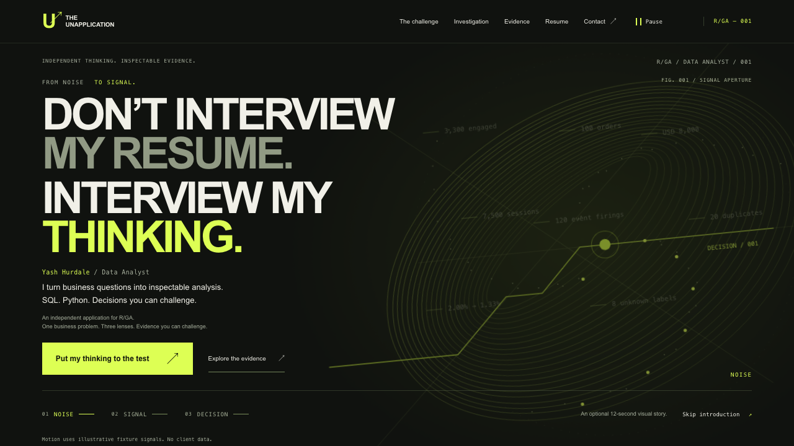

# THE UNAPPLICATION

### FROM NOISE TO SIGNAL.

DON'T INTERVIEW MY RESUME. INTERVIEW MY THINKING.

An independent, interactive application by **Yash Hurdale**, tailored to the supplied **R/GA Data Analyst** target. A fictional campaign gains engagement without gaining revenue. Choose an investigation, challenge its assumptions and download a decision you can defend.

**THE UNAPPLICATION is the recruiter-facing experience. [Exclamation AI](https://github.com/yashayyy27/exclamation-ai) is the separately maintained engineering proof.** Exclamation AI is unchanged. Selected work from PULSE, RESTOPS and Apex Insights is linked with explicit evidence limits.



## Current review

[Performance and recruiter readiness report](docs/recruiter-readiness/REVIEW.md) · [approved resume release instructions](docs/RESUME-RELEASE.md). The current branch preserves the cinematic identity and complete analytical journey. The challenge navigation now reaches the red team directly; the primary opening CTA starts with the business question.

## Cinematic edition · v2

An original procedural signal aperture moves from noise to clarity in an optional 12-second introduction. Touch users start it with the visible Play control; desktop playback begins after the first static frame. The headline, identity, challenge and evidence navigation are usable from the first frame. Pause/skip controls, reduced-motion and Save-Data support are built in; no video, external font, WebGL runtime or new dependency is required.

The investigations now have count-preserving event separation, live attribution flows and cohort-volume diagrams. Each of the six red-team challenges has a corresponding explanatory signal state. The final ivory decision scene exposes the finding, uncertainty, action and evidence. All original analysis and brief-export functions remain unchanged.

- [Creative treatment and official reference study](docs/cinematic-v2/CREATIVE-TREATMENT.md)
- [Verification, visual review and performance comparison](docs/cinematic-v2/REVIEW.md)
- [Desktop](docs/screenshots/v2/desktop-hero.png) · [mobile](docs/screenshots/v2/mobile-hero.png) · [decision](docs/screenshots/v2/desktop-decision.png)

This branch is for review. Nothing has been deployed, published or made public. Resume navigation reaches an honest availability note until an approved file is supplied.

## Run locally

Use **Node 24 LTS** (see `.nvmrc`) and npm. No keys, account, paid API, database or backend is needed.

```sh
git clone https://github.com/yashayyy27/THE-UNAPPLICATION.git
cd THE-UNAPPLICATION
npm ci
npm run dev
```

Open `http://127.0.0.1:4173`. The repository starts private; cloning requires owner access.

```sh
npm run check                  # strict types, Vitest + React tests, static production build
npx playwright install chromium
npm run test:e2e                # desktop/mobile, downloads, keyboard and axe checks
npm run preview                # serve the production out/ directory
```

`npm run build` exports a complete static site to `out/`. The prebuild regenerates the fixture, evidence manifest and minified scene styles, and verifies any approved resume against its file size and SHA-256. Python is optional: `python3 -m pip install reportlab` then `python3 scripts/build-brief.py` regenerates the default PDF.

## A 60–90 second route

1. **The hook:** a clear purpose and candidate identity.
2. **The question:** rising engaged sessions, flat purchases and revenue. Every number is explicitly synthetic.
3. **Choose a lens:** measurement integrity, marketing effectiveness or customer behaviour. Move a sensitivity slider, switch attribution rules or inspect visitor cohorts.
4. **Challenge it:** tracking, sample size, attribution, missingness, causality or cost. The response names what survives, what changes and what evidence is needed.
5. **Make a decision:** the selected challenge updates the recommendation. The downloaded HTML brief retains the investigation, cohort/attribution selection, challenge and numerical assumptions. Print it to a one-page PDF; a default PDF is also available.
6. **Follow the proof:** commit-pinned SQL, Python, Google receipts and an adversarial evaluation replay. Then explore further work or contact Yash through existing public professional channels.

Timing is a design target, not the result of a recruiter study. Deeper inspection remains optional.

## Evidence rules

- The campaign fixture and three-journey attribution mini-fixture are invented. They are not Google, R/GA or client performance.
- The genuine Google historical exercise and owner test-event receipts belong to Exclamation AI. This project links to the audited revision rather than duplicating or silently changing those results.
- Upstream historical test counts are labelled as historical. This project's observed verification is in [VERIFICATION](docs/VERIFICATION.md).
- No live AI calls or simulated AI claims. Numerical results come from pure tested functions.
- No tracking, sign-up, cookies, API keys or unsolicited development-tool credits.
- The official role listing was unavailable; exact job requirements/current vacancy status remain unverified. Company positioning comes from [R/GA's official About page](https://www.rga.com/about).
- No approved resume was supplied. No resume, qualification, employment, client outcome or uplift claim was invented.

## Handover

- [Product, journey, design and risks](docs/PRODUCT.md)
- [Research and evidence classification](docs/RESEARCH.md)
- [Evidence manifest](docs/EVIDENCE-MANIFEST.md) · [machine-readable manifest](public/evidence-manifest.json)
- [Architecture and analytical walkthrough](docs/ARCHITECTURE.md)
- [Deployment and owner review](docs/DEPLOYMENT.md)
- [Verification and known limitations](docs/VERIFICATION.md)
- [Default one-page brief](public/decision-brief.pdf) · [mobile screenshot](docs/screenshots/mobile.png)

Independent candidate project. Not affiliated with or endorsed by R/GA. Original code: MIT; dependency licences are preserved.
