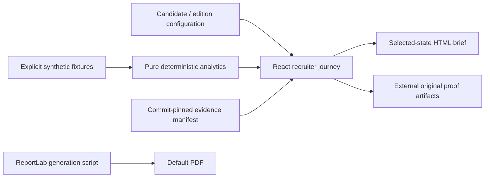

# Architecture and owner walkthrough

Next.js App Router, React, TypeScript, static export. CSS variables and native controls provide the design system. System fonts avoid external font requests. No backend, live model, personal-data store, telemetry or analytics script is part of the experience. Next build telemetry is explicitly disabled.

- `content/edition.ts`: candidate identity and public contact, employer/role edition, claim/evidence metadata, investigation and challenge content, selected work. Future editions replace this configuration and relevant challenge copy; no tenancy platform is needed.
- `content/scenario.ts`: the invented two-period campaign, mutually exclusive new/returning cohorts and separate three-journey attribution illustration. No mixing with historical Google results.
- `lib/analytics.ts`: conversion, relative change, Wilson uncertainty, missingness sensitivity, attribution allocation and contribution break-even. Invalid counts/nonfinite inputs fail explicitly; zero denominators return unavailable.
- `components/Unapplication.tsx`: native-control state, visible interpretations and executive decision. No user state is persisted or transmitted. Leaving the page resets the demo.
- `lib/brief.ts`: validates selections, composes a current-state brief, escapes HTML and triggers a local Blob download. No untrusted HTML injection or external generation service.
- `scripts/export-content.mjs`: regenerates downloadable scenario, JSON evidence manifest and Markdown evidence table from the same configuration.
- `scripts/build-brief.py`: reproducible default PDF. The static default intentionally has default settings; the HTML download contains the current choices and prints to one page.

## Explain the numbers

Engagement change is `(3300 - 2000) / 2000 = 65%`. Session conversion is `100 / 5000 = 2%` then `100 / 7500 = 1.3333%`. That describes observations; it does not attribute their cause.

For missingness `m`, purchases are modelled as `observed / (1 - m/100)`. At 20%, that is 125, not 120. This assumes uniformly missing true orders; it does not identify missing orders or recover revenue.

The attribution mini-fixture totals USD 150. First touch gives Email 100 / Paid search 50 / Organic 0. Last touch gives Organic 150. Linear gives Email 50 / Paid search 25 / Organic 75. Allocation conventions change credit, not incrementality.

Cohort stage counts add exactly to the total. Returning conversion is 80/2000 = 4% in both periods. New visitor conversion changes from 20/3000 to 20/5500. Aggregates cannot resolve consent, intent or seasonality without better evidence.

Wilson uses z=1.96 and an independent-Bernoulli approximation. Sessions may not be independent; a labelled interval is not a causal claim or power analysis. Break-even is `ceil(deliveryCost / contributionPerIncrementalOrder)`; contribution is assumed USD 40, not observed profit.

## Evidence boundary

The source excerpt shown in the UI is simplified explanatory logic, explicitly labelled. The external link opens the exact SQL/Python implementation. This repository does not proxy cloud services or reproduce a model's outputs. Upstream receipts substantiate documented historical runs, not a fresh cloud audit.

## Maintenance

Run Node 24, edit content, then `npm run check` and `npm run test:e2e`. Update a pinned evidence revision only after inspecting the relevant artifact and its limitations. Regenerate PDF if default copy changes; render and inspect all pages. Do not add credentials to client code or equate simulated outcomes with achievements. The owner should explain the calculations above and defend why the recommendation changes before sharing the experience.

## Cinematic presentation layer (v2)

`MotionSystem.tsx` owns a finite intro clock and session-only pause, reduced-motion, Save-Data, viewport and visibility handling. Motion starts only after preferences are available; server/no-JS output is complete and static. `SignalHero.tsx` authors the procedural aperture and labels from existing fixture inputs. Its finite transform runs on an HTML layer instead of repeatedly transforming an SVG group. `AnalyticalVisuals.tsx` uses compact SVG paths to display exact event counts, attribution credit and cohort volumes; the adjacent accessible readouts retain all numerical meaning. `Scene` adds finite intersection-triggered line reveals without hiding content.

No analytics functions, fixtures, evidence revisions, brief exporters, production dependencies or Exclamation AI files change in this redesign. See the [creative treatment](cinematic-v2/CREATIVE-TREATMENT.md) and [review](cinematic-v2/REVIEW.md).

Optional intro playback is scheduled after browser idle (with a bounded fallback), so it does not take priority over hydration and first paint. Supporting diagrams activate near the viewport with reserved space and a static poster; analytical readouts and controls are present independently of that enhancement.

## Recruiter readiness pass

The first frame contains the complete headline, identity, business question, exact analytical readouts, evidence links and native navigation. The header challenge shortcut goes directly to the red team; the opening primary CTA goes to the business problem. No intro completion is required.

`app/globals.css` holds first-frame styles and motion preferences. `styles/scenes.css` is the readable source for investigation, challenge, decision and evidence styling; prebuild minifies it to `public/scenes.css` using the CSS compiler already bundled with Next. Scene CSS downloads concurrently with a print media hint. A native first-paint listener applies it independently of React hydration, with a full noscript stylesheet fallback. First-frame geometry remains stable if it arrives late. Stylesheet failure retains the readable core and functional controls.

The browser skips offscreen chapter layout/paint with `content-visibility: auto`. Any native hash target opts chapters back into full layout through `html:has(:target)`, so estimated heights cannot move anchor destinations. Unsupported browsers use normal layout. Printing always expands chapters. The auto state preserves normal document and accessibility availability ([MDN](https://developer.mozilla.org/en-US/docs/Web/CSS/Reference/Properties/content-visibility)); physical screen-reader review remains a release check.

Original hero geometry lives in `styles/signal-aperture.svg`, consolidated into three opacity bands. Prebuild embeds it as a CSS image in generated `app/artwork.css`; there is no media request, document vector subtree or client geometry computation. Floating signal labels use HTML transforms; the hero no longer animates SVG stroke dash offsets. The complete static composition paints before load/two animation frames/idle enhancement. On touch/coarse-pointer devices, a visible Play introduction control starts the complete sequence on demand; desktop starts automatically after that first paint. Existing pause, skip, visibility, reduced-motion and Save-Data rules still apply. Static evidence is memoized and the hero element remains stable during analytical state changes.

`ViewportVisual` uses an observer to load analytical diagram code with React lazy/Suspense near its scene. Numerical readouts and controls are never deferred. Reserved heights prevent layout shifts. Loading and error boundaries retain a labelled procedural poster if a diagram chunk fails; calculations, evidence and briefs remain usable.

Resume source-of-truth is `content/resume.json`; no file is currently approved. Prebuild checks a configured local PDF's approval record, header/end marker, length and SHA-256. This verifies file identity, not credentials or PDF accessibility. See `docs/RESUME-RELEASE.md` for the owner handoff.

The original `briefText` model is shared in `lib/brief-model.ts`. Its calculations and strings are unchanged; `lib/brief.ts` retains compatible exports and the original HTML/export bodies. The HTML template is fetched on download intent, with pointer/focus warm-up, visible preparation/error states and retry. A selection-revision guard keeps a delayed click-time snapshot from claiming to export a newer analysis. The real default PDF remains available if generation fails.
