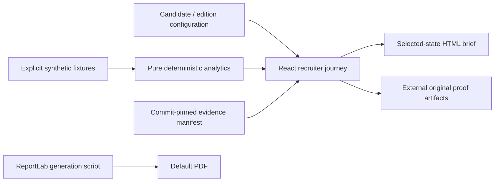

# Architecture and owner walkthrough

Next.js App Router, React, TypeScript, static export. CSS variables and native controls provide the design system. System fonts avoid external font requests. No backend, live model, personal-data store, telemetry or analytics script is part of the experience. Next build telemetry is explicitly disabled.

- `content/edition.ts`: candidate identity and public contact, employer/role edition, claim/evidence metadata, investigation and challenge content, selected work. Future editions replace this configuration and relevant challenge copy; no tenancy platform is needed.
- `content/scenario.ts`: the invented two-period campaign, mutually exclusive new/returning cohorts and separate three-journey attribution illustration. No mixing with historical Google results.
- `lib/analytics.ts`: conversion, relative change, Wilson uncertainty, missingness sensitivity, attribution allocation and contribution break-even. Invalid counts/nonfinite inputs fail explicitly; zero denominators return unavailable.
- `components/Unapplication.tsx`: native-control state, visible interpretations and executive decision. No user state is persisted or transmitted. Leaving the page resets the demo.
- `lib/brief.ts`: validates selections, composes a current-state brief, escapes HTML and triggers a local Blob download. No untrusted HTML injection or external generation service.
- `scripts/export-content.mjs`: regenerates downloadable scenario, JSON evidence manifest and Markdown evidence table from the same configuration.
- `scripts/build-brief.py`: reproducible default PDF. The static default intentionally has default settings; the HTML download contains the current choices and prints to one page.

## Explain the numbers

Engagement change is `(3300 - 2000) / 2000 = 65%`. Session conversion is `100 / 5000 = 2%` then `100 / 7500 = 1.3333%`. That describes observations; it does not attribute their cause.

For missingness `m`, purchases are modelled as `observed / (1 - m/100)`. At 20%, that is 125, not 120. This assumes uniformly missing true orders; it does not identify missing orders or recover revenue.

The attribution mini-fixture totals USD 150. First touch gives Email 100 / Paid search 50 / Organic 0. Last touch gives Organic 150. Linear gives Email 50 / Paid search 25 / Organic 75. Allocation conventions change credit, not incrementality.

Cohort stage counts add exactly to the total. Returning conversion is 80/2000 = 4% in both periods. New visitor conversion changes from 20/3000 to 20/5500. Aggregates cannot resolve consent, intent or seasonality without better evidence.

Wilson uses z=1.96 and an independent-Bernoulli approximation. Sessions may not be independent; a labelled interval is not a causal claim or power analysis. Break-even is `ceil(deliveryCost / contributionPerIncrementalOrder)`; contribution is assumed USD 40, not observed profit.

## Evidence boundary

The source excerpt shown in the UI is simplified explanatory logic, explicitly labelled. The external link opens the exact SQL/Python implementation. This repository does not proxy cloud services or reproduce a model's outputs. Upstream receipts substantiate documented historical runs, not a fresh cloud audit.

## Maintenance

Run Node 24, edit content, then `npm run check` and `npm run test:e2e`. Update a pinned evidence revision only after inspecting the relevant artifact and its limitations. Regenerate PDF if default copy changes; render and inspect all pages. Do not add credentials to client code or equate simulated outcomes with achievements. The owner should explain the calculations above and defend why the recommendation changes before sharing the experience.
